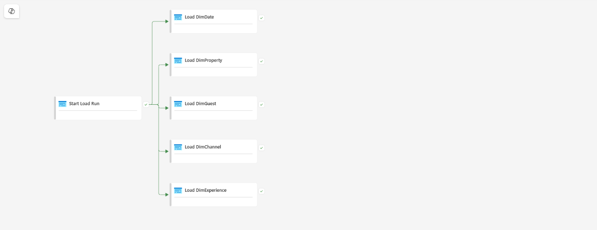
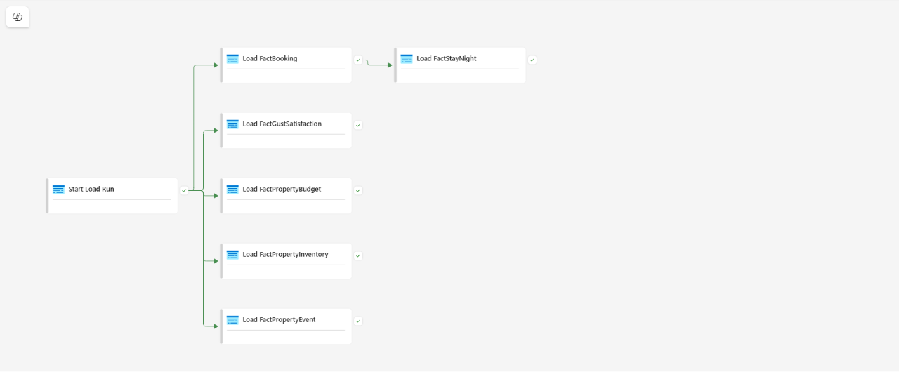
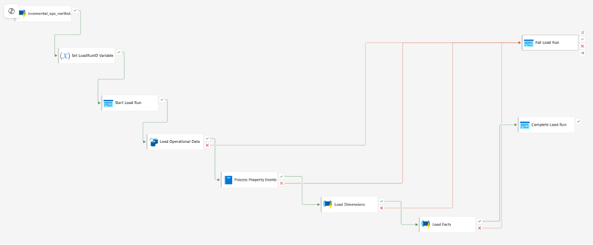

# Fabric Explained Pipelines

These are sanitized Fabric DataPipeline definitions. For this course, create pipelines in Fabric and copy/paste the configured JSON using **View > Edit JSON** as described below. Configure the bindings first; the placeholder-bound files are not runnable. These JSON files are not native ZIP templates for the pipeline template gallery.

| File | Purpose |
| --- | --- |
| [pl_load_northstar_dimension.json](pl_load_northstar_dimension.json) | Conditionally start a load run, then load the five Warehouse dimensions. |
| [pl_load_northstar_fact.json](pl_load_northstar_fact.json) | Conditionally start a load run, then load the six Warehouse facts. FactStayNight waits for FactBooking. |
| [pl_refresh_northstar.json](pl_refresh_northstar.json) | Generate a shared LoadRunID, start the run, invoke operational ingestion, process property events, load dimensions and facts, and record completion or failure. |

The refresh is standalone with respect to the original external Azure Data Factory pipeline. It still requires the Fabric Copy Job configured using the [operational ingestion guide](../guides/copy-job-ingestion.md). It refreshes Warehouse data; it does not refresh a Power BI semantic model.

## Prerequisites

- A workspace on a supported Fabric capacity, with Contributor access. The copy/paste setup does not require a Fabric API token or API-specific scopes.
- The `wh_northstar` objects from the [Warehouse scripts](../warehouse/README.md), with permission to execute the load and logging procedures.
- A schema-enabled `lh_northstar` with the operational tables in `landing`, using the names and structures expected by the Warehouse procedures.
- The [property-event notebook](../notebooks/README.md), attached to the correct default Lakehouse and supplied with its input files. It writes `processed.PropertyEvent` and `quarantine.PropertyEvent`.
- The `PropertyBudget` source exposing `dbo.[Property Budget]`, as required by the budget loader.
- A populated operational SQL source and a separately configured `cj_northstar_ops` Copy Job, following the [source setup and mappings](../guides/copy-job-ingestion.md). Complete its initial landing-table load before relying on the notebook or Warehouse sources. No importable Copy Job definition or CSV-to-SQL importer is included here.
- Fabric connections and permissions for the Copy Job and child-pipeline invocation activities. The job's SQL-source connection is separate from the pipeline's Fabric invocation connection. A connection ID is not the same as a workspace or item ID.

The procedures modify Warehouse data, and the notebook overwrites its two output tables. Inspect the linked scripts and source mappings before running these pipelines against existing data.

## Bindings

Configure local working copies rather than committing your environment's identifiers. Replace every occurrence, including the stored-procedure activity nested inside each child's `Start Load Run` condition.

| Placeholder | Replacement |
| --- | --- |
| `__WAREHOUSE_SQL_ENDPOINT__` | Warehouse SQL server hostname, without a URL scheme. |
| `00000000-0000-0000-0000-000000000001` | Target workspace ID. These definitions assume all referenced items are in that workspace. |
| `00000000-0000-0000-0000-000000000002` | Target Warehouse item ID. |
| `00000000-0000-0000-0000-000000000003` | Imported property-event notebook item ID. |
| `00000000-0000-0000-0000-000000000004` | Dimension pipeline item ID obtained during creation. |
| `00000000-0000-0000-0000-000000000005` | Fact pipeline item ID obtained during creation. |
| `00000000-0000-0000-0000-000000000006` | Operational Copy Job item ID. |
| `00000000-0000-0000-0000-000000000007` | Fabric connection ID for `Load Operational Data`. |
| `00000000-0000-0000-0000-000000000008` | Fabric connection ID for both `Load Dimensions` and `Load Facts`. |

Keep the expected source item names (`wh_northstar`, `lh_northstar`, and `PropertyBudget`) unless you also update the SQL that references them. The UUID-shaped markers above are deliberately non-live placeholders, not usable defaults.

Configure the Copy Job's SQL-source connection and destination Lakehouse within the job itself. The placeholder ending in `0007` is the Fabric connection used by `Load Operational Data` to invoke that job, not its SQL-source connection. Creating the job item or saving a pipeline does not seed the source database or configure those data connections for you.

## Create Pipelines With Copy/Paste JSON

This is the course setup path. Creating and saving a pipeline does not run it or create a schedule. Work with newly created lab pipelines; do not replace an existing working pipeline's definition.

1. In the target workspace, create a pipeline named `pl_load_northstar_dimension`.
2. In a local working copy of its JSON file, replace every Warehouse endpoint, workspace ID, and Warehouse item ID placeholder using the [binding table](#bindings). Include the stored-procedure activity nested inside `Start Load Run`.
3. Open **View > Edit JSON** in the pipeline editor. Copy the configured file's content **omitting the outermost opening `{` and closing `}`**. Paste it inside the editor's enclosing `{}` in place of its existing inner content, retaining those editor braces. Keep all nested braces and the `properties` content. This preserves the dimension copy/paste procedure confirmed for this course; do not remove the wrapper from the repository file itself.
4. Apply the editor changes and save the pipeline. Inspect its activities and Warehouse bindings, then record its item ID from the pipeline URL for use in the refresh definition.
5. Repeat steps 1-4 for `pl_load_northstar_fact`, using its own JSON file and display name. Record its item ID too. Confirm the conditional initialization and the dependency from `FactBooking` to `FactStayNight` remain intact.
6. Create `pl_refresh_northstar`. Configure a local copy of its JSON using all applicable entries in the binding table, including the two saved child-pipeline IDs, the notebook ID, the Copy Job ID, and the invocation connection IDs. Repeat the editor paste and save steps.
7. Before running the refresh, inspect every activity, connection, notebook attachment, and child-pipeline selection. Confirm that no placeholders remain and that all targets belong to the intended lab workspace. Creating these pipelines supplies no schedules, credentials, or permissions, and requires no Variable Library.

The dimension paste procedure was confirmed by the course author on November 23, 2026. The same procedure is the intended setup for fact and refresh, but their editor paste/save behavior has not yet been confirmed. Treat those two UI checks as pending, not as evidence of successful end-to-end execution. See [Validation](#validation) for the separate REST import checks.

## Other Import Options

### Native ZIP Templates

Fabric also supports [exporting and importing pipeline ZIP templates](https://learn.microsoft.com/en-us/fabric/data-factory/templates). This repository does not provide those ZIP packages. Uploading these raw JSON files, or simply zipping them, is not the documented native template import process. ZIP export/import and dependency rebinding have not been validated for these samples.

### Optional REST API Upload

The REST route below is an advanced alternative, not a prerequisite for the copy/paste setup. It requires a Fabric API token and an identity authorized for `DataPipeline.ReadWrite.All` or `Item.ReadWrite.All`, in addition to the workspace and runtime permissions above. Use the complete configured JSON file, including its outermost braces; the editor paste selection is not the REST payload.

The tested route is to create empty pipelines and then upload their configured definitions. Neither operation runs a pipeline or creates a schedule.

1. Create each of the three pipelines using its intended display name. The [Create Data Pipeline API](https://learn.microsoft.com/en-us/rest/api/fabric/datapipeline/items/create-data-pipeline) accepts this request:

   ```http
   POST https://api.fabric.microsoft.com/v1/workspaces/{workspaceId}/dataPipelines
   Authorization: Bearer {FabricAccessToken}
   Content-Type: application/json
   ```

   ```json
   {
     "displayName": "pl_load_northstar_dimension"
   }
   ```

2. Record each returned item ID. Substitute the correct display name for the fact and refresh pipelines. If creation returns `202 Accepted`, follow the operation's `Location` and `Retry-After` headers until it succeeds, then retrieve its result to obtain the item ID. Do not resubmit creation to wait for completion.

3. Resolve the Warehouse bindings in both child definitions, and upload those children first. Resolve all remaining bindings in the refresh definition, including the two new child IDs, then upload the refresh.

4. For each configured JSON file, encode its UTF-8 bytes as Base64. For example, from the directory containing your configured copy:

   ```powershell
   $payload = [Convert]::ToBase64String(
       [IO.File]::ReadAllBytes((Resolve-Path './pl_load_northstar_dimension.json').Path)
   )
   $body = @{
       definition = @{
           parts = @(@{
               path = 'pipeline-content.json'
               payload = $payload
               payloadType = 'InlineBase64'
           })
       }
   } | ConvertTo-Json -Depth 6
   ```

5. Submit `$body` as the JSON body of the [Update Item Definition API](https://learn.microsoft.com/en-us/rest/api/fabric/core/items/update-item-definition):

   ```http
   POST https://api.fabric.microsoft.com/v1/workspaces/{workspaceId}/items/{itemId}/updateDefinition
   Authorization: Bearer {FabricAccessToken}
   Content-Type: application/json
   ```

   This replaces the item's entire definition. Target only your newly created pipeline. A `200 OK` completes the update; a `202 Accepted` requires operation-state polling using `Location` and `Retry-After`. Do not request an item result or resubmit the update to wait for completion.

6. Open the imported pipelines in Fabric and inspect every activity, connection, notebook attachment, and child-pipeline selection before running. No `.platform`, schedules, credentials, or permissions are supplied by these files. Authentication must use a token for the Fabric API; keep it out of files and source control.

See the [DataPipeline definition reference](https://learn.microsoft.com/en-us/rest/api/fabric/articles/item-management/definitions/datapipeline-definition) for the REST payload structure.

## Running And Logging

Run `pl_refresh_northstar` for the full workflow. It creates a fresh GUID in `LoadRunID`, writes one `ctl.LoadRun` header, and passes the same ID to both children with `StartLoadRun = false`. The child loaders write their step details through the existing Warehouse procedures. The parent marks the run complete only after the facts finish.

`Load Operational Data` already uses `InvokeCopyJob`; no extra Copy activity is required. The notebook depends on this activity succeeding. During your first runtime test, confirm the Copy Job has completed before the notebook starts, not merely that its run request was accepted. Inspect Copy Job monitoring for per-table copy counts; `ctl.LoadRunDetail` records the Warehouse load steps instead. The [ingestion guide](../guides/copy-job-ingestion.md) explains full-load resets, incremental timestamps, upsert keys, and delete limitations.

For a direct dimension or fact run, supply a fresh GUID as the required `LoadRunID` parameter and leave the Boolean `StartLoadRun` parameter at its default `true`. These child pipelines do not complete or fail the header themselves. The caller must invoke `ctl.usp_complete_load_run` or `ctl.usp_fail_load_run` for that same ID afterward; otherwise the header remains `Running`. Set `StartLoadRun = false` only when the caller has already created that header.

On the full refresh failure path, a failed or skipped `Complete Load Run` triggers `Fail Load Run`, followed by an explicit `Fail Refresh` activity. The final failure is still raised if failure logging itself fails. If initialization or Warehouse access fails before a header can be written, use Fabric activity run history; there may be no matching `ctl.LoadRun` record.

Avoid concurrent refreshes or reuse of a LoadRunID. Inspect both `ctl.LoadRun` and `ctl.LoadRunDetail` alongside Fabric monitoring after execution.

## Changes From The Source

- Removed the external ADF nightly-pipeline invocation and made `Set LoadRunID Variable` the entry activity.
- Replaced environment-specific endpoints, workspace/item IDs, and connection IDs with the documented placeholders.
- Added the conditional child start and parent `StartLoadRun = false` arguments to avoid three header inserts for one run ID.
- Replaced the original failure logger's multiple `Failed` dependencies with the failed-or-skipped completion route, and added the explicit final failure activity.

Existing loader procedures, SQL parameters, activity policies, and load dependencies are otherwise retained. The original `Load FactGustSatisfaction` activity-name typo is retained; its stored-procedure reference is unchanged.

## Reference Screenshots

These cropped screenshots show the live reference pipelines, not exact renderings of the sanitized JSON definitions. Browser URLs and account controls have been removed. The images illustrate orchestration layouts; they are not evidence of successful pipeline execution. See [Changes From The Source](#changes-from-the-source) for the differences implemented in this repository.

### Dimension Loading



The reference pipeline starts the load run and fans out to the five dimension loaders. The repository template makes this initialization conditional through `StartLoadRun` so a parent can reuse its existing load-run header.

### Fact Loading



`FactBooking` loads before `FactStayNight`; the other fact loaders run in parallel after load-run initialization. As with the dimension template, the repository's fact template adds conditional initialization.

### Refresh Orchestration



The reference refresh coordinates operational ingestion, property-event processing, dimension loading, fact loading, and load-run logging. This image includes the original external ADF invocation and failure-logging connections. The repository template removes that invocation, revises the failure route, and adds the explicit `Fail Refresh` activity.

## Validation

Validation on November 21, 2026 covered JSON parsing, source-preservation checks, placeholder-only public bindings, dependency references, shared-ID/header settings, booking-before-stay ordering, and an offline simulation of the success route and eight failure scenarios.

All three configured definitions were uploaded into temporary, unscheduled Fabric pipelines and retrieved again. Each saved content definition matched its configured upload exactly. Direct placeholder-bound uploads were rejected; configure the bindings before uploading. The temporary pipelines were deleted afterward.

On November 23, 2026, the course author confirmed that copying/pasting the dimension JSON while omitting the file's outermost `{}` worked in **View > Edit JSON**. The fact and refresh editor imports, native ZIP imports, and Variable Library bindings have not been validated. The copy/paste documentation update leaves all three JSON definitions unchanged.

No pipeline was executed during validation. Import acceptance is not proof that connections, SQL loads, Copy Job ingestion, notebook invocation, or end-to-end logging will succeed in a new environment. The live lab pipelines were not modified.